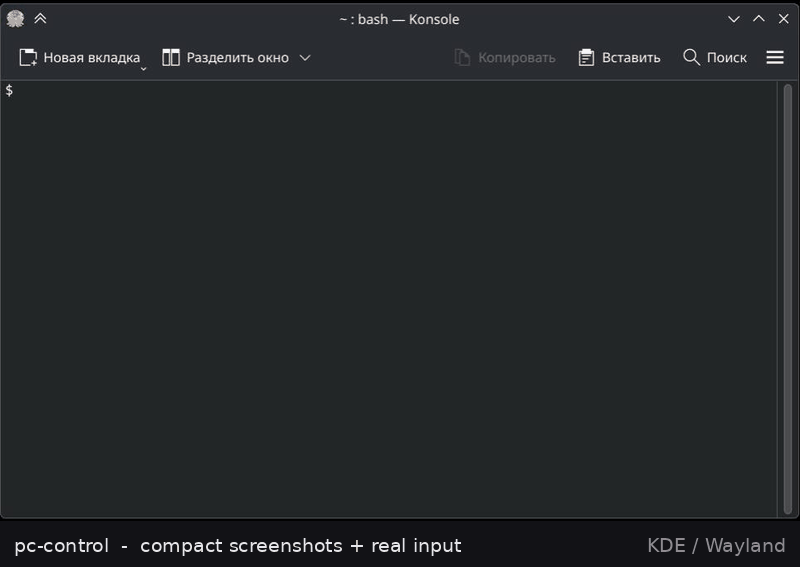

# pc-control

[](https://github.com/linuxgamer/pc-control/actions/workflows/test.yml)
[](LICENSE)

`pc-control` is a small, dependency-light CLI that gives an llm screenshots,
mouse, keyboard, window focus, and app switching on Wayland or X11. Every call
prints one JSON object, so it composes cleanly with tool-using models.



It can work with any llm(**multimodality recommended**) that can run python. The skill is in [`etc/SKILL.md`](etc/SKILL.md), generic instructions are in [`etc/USAGE.md`](etc/USAGE.md).

```
agent ── shell ──► pc-control ──► spectacle / grim / gnome-screenshot ──► compact JPEG
                      └────────► ydotool ──► ydotoold ──► /dev/uinput ──► apps & games
```

## Harness support

`pc-control` is **harness-agnostic**: one Python file, no imports from DeepSeek
Harness, one JSON object per call. Any runtime that can run shell commands and
read an image can drive it.

- [`etc/USAGE.md`](etc/USAGE.md) — generic system-prompt snippet, JSON contract,
  token strategy, batch format.
- [`etc/SKILL.md`](etc/SKILL.md) — the same guidance in DeepSeek Harness skill
  format (works as a plain instruction document too).
- `install.sh` installs the skill into `~/.dsh/skills` by default; use
  `--skill-dir DIR` for another harness, or `--no-skill` for the CLI only.

## Features

- **Simulates real input** — `ydotool` creates a kernel virtual device, so
  native Wayland apps *and games* receive mouse/keyboard, including relative
  look.
- **Saves tokens** — compacts screenshots (1280 px) by default, `--region`
  crops, `--ocr` returns text, `--grid` for precise coordinates, `--full` when
  quality matters.
- **Automatic coordinate mapping** — coordinates from a downscaled or cropped
  shot are mapped back to native pixels; no manual scale math.
- **Closed-loop mouse movement** — reads the real cursor via KWin, learns
  pointer acceleration, and lands within ~2 px.
- **Window focus** — `focus` unminimizes and activates by title/class, so you
  never have to click a title bar.
- **Batch actions** — `run` chains shot → move → click → verify in one call.
- **Portable** — KDE, GNOME, and wlroots capture backends; distro-agnostic
  setup for `uinput` + `ydotool`; single-file Python CLI.

## Install

```bash
git clone https://github.com/linuxgamer/pc-control.git
cd pc-control
./install.sh                 # ~/.local/bin/pc-control + ~/.dsh/skills/pc-control
sudo ./setup-uinput.sh       # once: uinput module, udev rule, ydotoold
pc-control doctor
```

`install.sh` needs no sudo. `setup-uinput.sh` installs `ydotool` with your
package manager (pacman/apt/dnf/zypper), loads `uinput`, adds one udev rule, and
runs `ydotoold` with a socket owned by your user (`/run/ydotool.sock`, mode
0600).

From a checkout with pip or pipx:

```bash
pipx install .          # isolated, puts pc-control on PATH
# or
python3 -m pip install --user .
```

For a checkout without installing:

```bash
./install.sh --local         # ./.pc-control/bin + ./.dsh/skills
./pc-control doctor
```

Requirements: Python 3.9+, Pillow (compact/grid/region), one screenshot backend,
`ydotool` + root `ydotoold`. Optional: `tesseract` for OCR, KDE Plasma for
cursor/focus feedback.

## Quick start

```bash
pc-control shot                  # compact screenshot, prints JSON with path
pc-control shot --grid           # + 100 px grid for picking coordinates
pc-control click left --at 640 360
pc-control type "hello"
pc-control key ctrl+s
pc-control shot --ocr            # text instead of pixels
pc-control focus konsole
pc-control run '[{"action":"shot"},{"action":"click","at":[640,360]},{"action":"shot"}]'
```

Read the image at the returned `path` with your agent's image tool, or use
`--ocr` for text-only mode.

## More commands

```text
doctor | screen
shot [--window|--screen] [--region X Y W H] [--grid] [--ocr] [--ocr-lang L]
     [--full] [--max-width N] [--out PATH]
move X Y [--native] [--scaled] [--dry-run]
move-rel DX DY [--dry-run]
click [left|right|middle|side|extra] [--double] [--at X Y] [--native] [--dry-run]
down|up [button]
key KEYS [--hold MS] [--dry-run]        # ctrl+s, space, alt+F4, f1...
type TEXT                               # US layout / ASCII
scroll N [--horizontal]                 # negative = down
wait MS
run JSON [--continue-on-error]
active | cursor | focus PATTERN
pause [--reason TEXT] | resume | status
```

`run` actions: `shot`, `move`, `move-rel`, `click`, `down`, `up`, `key`, `type`,
`scroll`, `wait`, `focus`, `active`, `cursor`, `screen`, `status`.

## Apps and games

Launch an app through the desktop launcher (works on any desktop):

```bash
pc-control key meta
pc-control type "konsole"
pc-control key enter
```

For games, start the game on the host first, then drive it:

```bash
pc-control move-rel 120 0        # turn right
pc-control key w --hold 1000     # walk forward
pc-control down left             # fire
pc-control up left
```

Each observe→act cycle is ~1–3 s: fine for menus, walking, and chat, not for
live aiming.

## Troubleshooting

| Symptom | Check |
|---|---|
| A click seems ignored | Take a fresh `shot` first. A collapsed sidebar, hidden panel, or moved window changes the layout, so an old coordinate now hits empty space. |
| A window disappeared | You clicked its title bar; `focus PATTERN` restores it. |
| `move` reports a warning | Retry once; if it persists, take a shot and verify the pointer's effect. |
| `no screenshot backend` | Install `spectacle`, `grim`, `gnome-screenshot`, `wayshot`, or `scrot`. |
| `ydotool failed` | `pc-control doctor`; check `ydotoold` and the socket. |
| `error:"human_paused"` | The human paused control; stop and ask them to `pc-control resume`. |
| `error:"human_override"` | The cursor moved before the click; do not retry blindly — take a fresh shot. |
| OCR text looks wrong | Check `ocr_lang` in the shot JSON; install the matching Tesseract language and pass `--ocr-lang` (e.g. `rus`). Mixed/Cyrillic UI can still transliterate. |

## Configuration

| Variable | Default | Meaning |
|---|---|---|
| `PC_STATE_DIR` | `./.pc-control` | Shots, last-shot geometry, KWin helpers |
| `PC_SCREENSHOT_BACKEND` | auto | `spectacle`, `grim`, `gnome-screenshot`, `wayshot`, `scrot`, `import` |
| `PC_OCR_LANG` | from `LANG`, then `eng` | Tesseract language |
| `YDOTOOL_SOCKET` | `/run/ydotool.sock` | Daemon socket |

## Development

```bash
python3 -m unittest discover -s etc -v
./pc-control --help
```

Layout:

```
pc-control       single-file CLI (stdlib; Pillow optional)
setup-uinput.sh  one-time root setup
install.sh       user-level installer (CLI + skill)
etc/SKILL.md     skill for any harness
etc/USAGE.md     generic agent instructions
```

## License

MIT — see [LICENSE](LICENSE).
